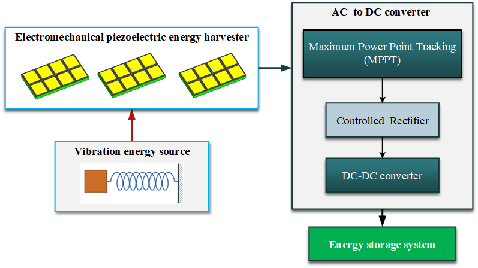
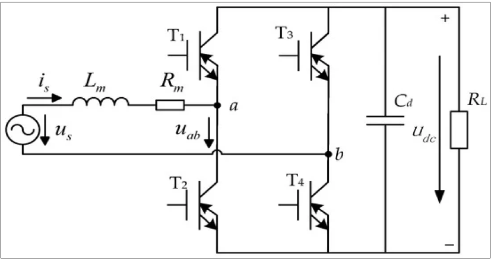
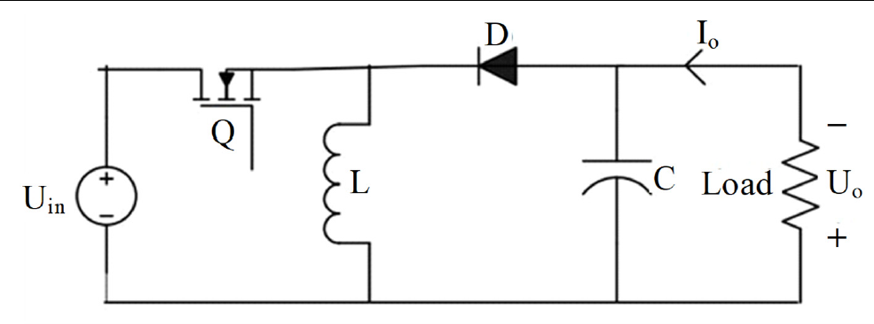
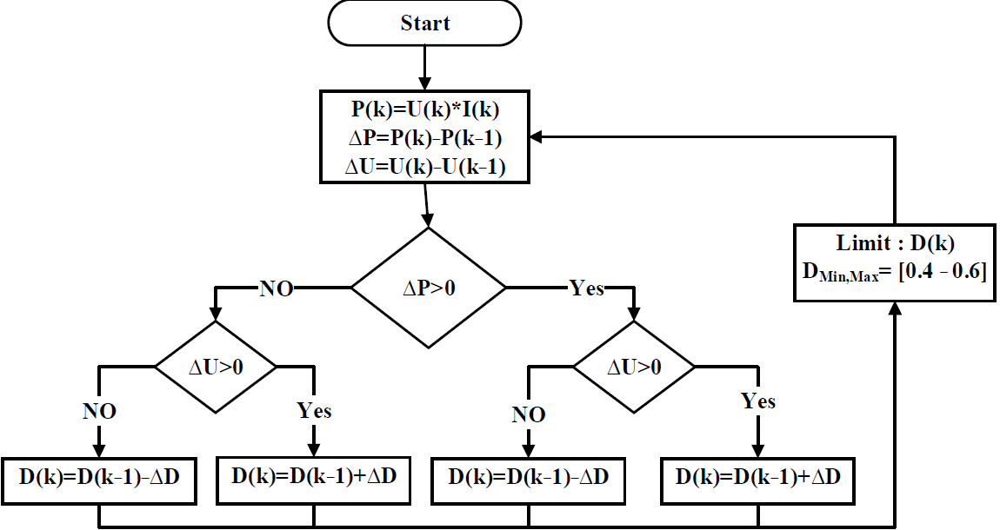
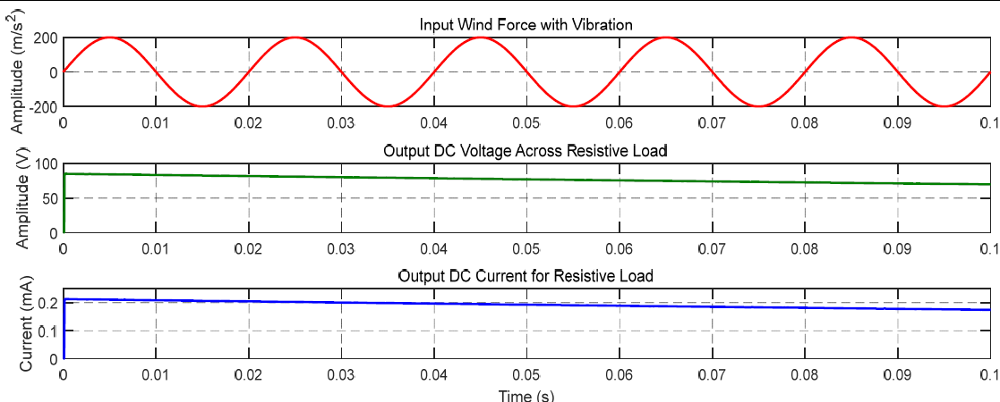
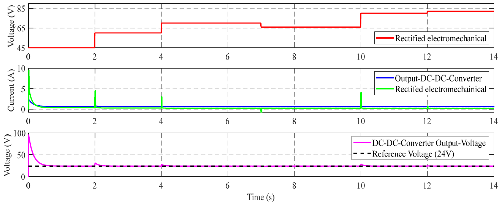
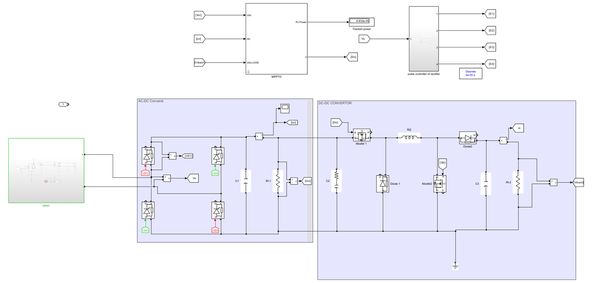
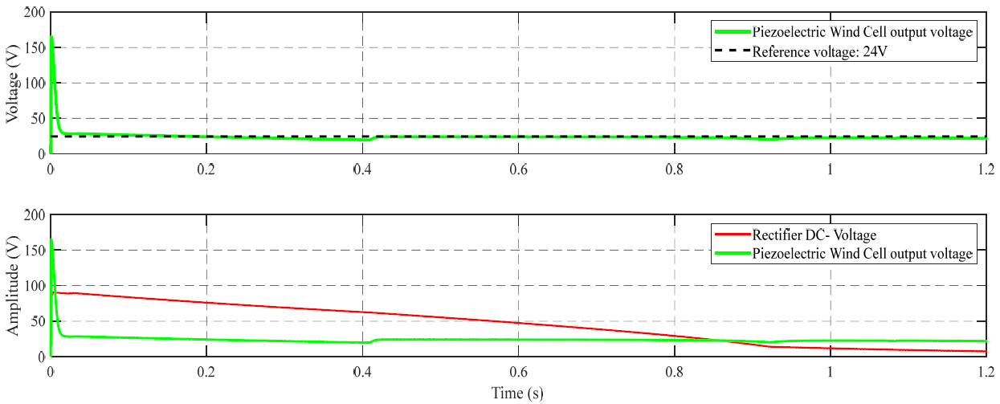

# Piezoelectric Energy Harvester — PWM Rectifier, Buck-Boost & P&O MPPT (MATLAB/Simulink)

**Power Electronics & Drives (EE042-4-3) · Asia Pacific University · 2025**

A full Simulink model of a vibration-powered energy harvester. It covers a **mechanical mass–spring–damper** piezo source, a **single-phase PWM full-wave rectifier**, and a **buck-boost DC-DC converter**. A **Perturb & Observe MPPT** loop holds the output at a regulated **24 V** while the input vibration changes.

## Highlights

- Modelled the harvester as a 2nd-order system, `F(t) = M·ẍ + c·ẋ + k·x`, with transfer function `H(s) = 1 / (Ms² + cs + k)`. Using M = 3.6 kg, k = 4,000 N/m and c = 100 N·s/m gives **ωₙ = 33.3 rad/s (fₙ = 5.31 Hz)** and **ζ = 0.417** (underdamped).
- Built a **4-switch PWM bridge rectifier** (5 kHz) and a **buck-boost converter** (20 kHz, L = 45 µH, C = 100 µF), each sized analytically first and then checked in simulation.
- Swept the vibration frequency from **0.5 Hz to 150 Hz** at 200 N force amplitude. The rectified DC output varied widely (**7.6–71 V**) at low frequency and settled at a steady **80–82 V at 150 Hz**.
- Closed the loop with a **P&O MPPT** controller that adjusts the converter duty cycle in real time (limited to D = 0.4–0.6). The **output tracked the 24 V reference** despite input fluctuations.

## Circuits

| PWM single-phase bridge rectifier | Buck-boost converter |
|---|---|
|  |  |

## MPPT logic (Perturb & Observe)

Each step compares the change in power (ΔP) with the change in voltage (ΔU) and nudges the duty cycle D up or down by ΔD toward the maximum power point. D is clamped to [0.4, 0.6].

## Simulation results

| Rectifier output at 150 Hz vibration | Buck-boost closed-loop regulation |
|---|---|
|  |  |

**Full integrated model and its output tracking the 24 V reference:**

## Design calculations

| Parameter | Value |
|---|---|
| Natural frequency | 5.31 Hz |
| Damping ratio | 0.417 |
| Rectifier switching frequency | 5 kHz |
| Converter switching frequency | 20 kHz |
| Inductor / capacitor | 45 µH / 100 µF |
| Ideal PWM rectifier output (D = 0.5, 100 V peak) | 31.8 V |
| Buck-boost output at D = 0.5 | 31.8 V |
| Load | 4 kΩ → 7.96 mA, 0.25 W |

## Simulink models

Built in MATLAB R2024b. Open in Simulink and press Run.

| File | What it is |
|---|---|
| [`simulink/AC_DC_CONVERTOR.slx`](simulink/AC_DC_CONVERTOR.slx) | Stage 1: piezo mass–spring–damper source and PWM full-wave rectifier with its pulse controller |
| [`simulink/Closed_loop_buck_boost_test.slx`](simulink/Closed_loop_buck_boost_test.slx) | Stage 2: buck-boost converter with the P&O MPPT block and discrete PID voltage loop |
| [`simulink/title4.slx`](simulink/title4.slx) | Full integrated system: harvester → rectifier → MPPT-controlled buck-boost → load |

## Takeaways and next steps

- The harvester is far more effective at higher vibration frequencies. Tuning fₙ toward the dominant source frequency is the biggest lever for efficiency.
- P&O MPPT is simple and robust but oscillates around the maximum power point. Adaptive-step P&O or incremental conductance would reduce that ripple.
- Next: add storage (supercapacitor or battery) charge control, and validate with a physical piezo stack.

## Tools

MATLAB · Simulink · Simscape Electrical (power electronics blocks)
